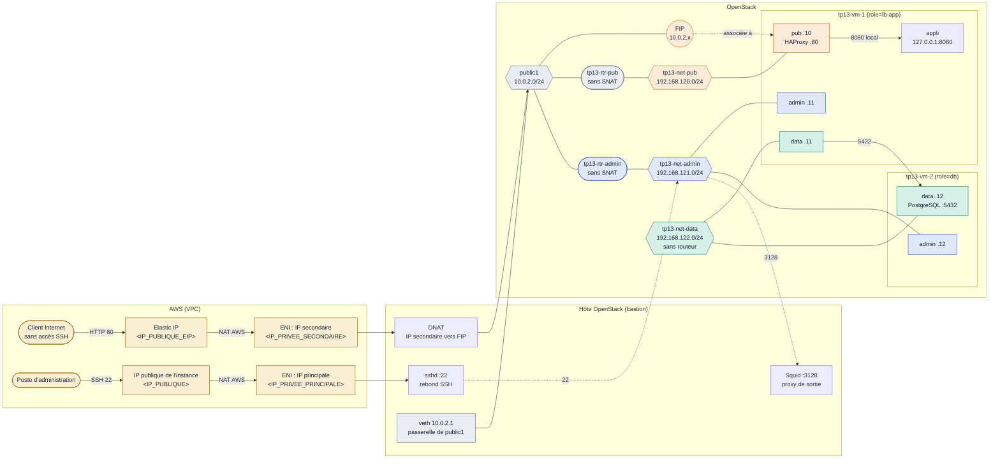
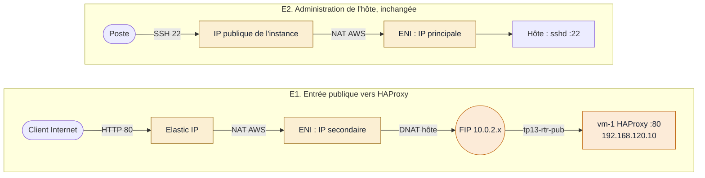
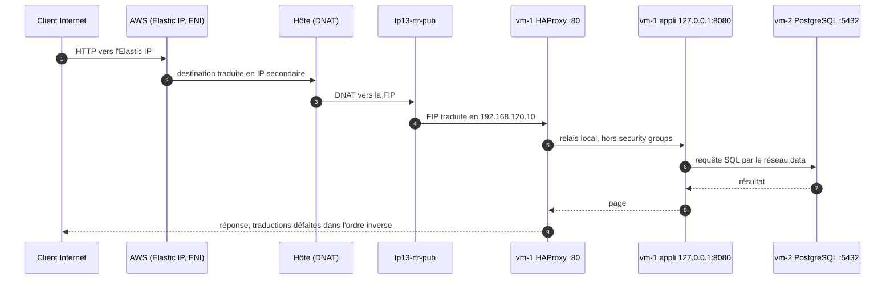

# TP 13. Architecture de déploiement sur OpenStack

> Un serveur applicatif (vm-1, avec HAProxy) et un serveur de base de données (vm-2), répartis sur
> trois réseaux : publication, administration et data. L'hôte OpenStack sert de bastion SSH et de
> proxy de sortie. Seule la FIP de HAProxy est publiée sur Internet, par une IP secondaire de l'ENI et
> une Elastic IP.
>
> Ce document présente le TP final du parcours et l'architecture que vous allez construire.

| Version | État | Plateforme | Préfixe des ressources |
|---|---|---|---|
| 2026-10-18 | Conception : rien n'est encore déployé ni testé | Lab All-in-One Kolla-Ansible sur AWS EC2, scénario 04 | `tp13-` |

| VM | Réseaux internes | Routeurs | Cartes réseau | Security groups | FIP publiée sur Internet |
|:-:|:-:|:-:|:-:|:-:|:-:|
| 2 | 3 | 2, sans SNAT | 5 | 4 | 1 |

---

## 1. Ce que vous allez construire

Au terme du parcours, vous déployez de bout en bout une application web et sa base de données.
L'application est publiée sur Internet, et l'ensemble est protégé comme en production : une seule porte
d'entrée, des réseaux séparés par usage, un pare-feu par carte réseau, aucune sortie directe vers
Internet. Vous le faites sur un vrai cloud OpenStack que vous avez vous-même installé, sur une vraie
instance AWS.

**Ce que vous saurez faire**

- Concevoir une architecture réseau segmentée : publication, administration, données.
- Écrire des règles de security group au plus juste, en entrée et en sortie, avec des groupes plutôt
  que des adresses.
- Publier un service sur Internet à travers deux couches réseau, AWS puis OpenStack, et expliquer
  chaque traduction d'adresse.
- Administrer des VM uniquement par un bastion, et contrôler leurs sorties par un proxy filtrant.
- Diagnostiquer une panne réseau saut par saut avec `tcpdump`, et prouver qu'un flux interdit l'est
  vraiment.
- Nommer, étiqueter et nettoyer des ressources comme dans une équipe d'exploitation.

**Comment vous apprenez**

- Un lab réel, pas une simulation : OpenStack 2025.1 déployé par Kolla-Ansible, sur AWS EC2.
- Chaque commande des TP est rejouée sur le lab avant publication.
- On fait constater plutôt qu'affirmer : chaque règle de sécurité est vérifiée par un test qui
  réussit et un test qui échoue.
- Des pièges réels, rencontrés en exploitation, à diagnostiquer vous-même.
- Les coûts sont maîtrisés : tout est gratuit, sauf une étape optionnelle signalée et soumise à
  l'accord du tuteur.

---

## 2. Les principes de sécurité mis en œuvre

Chaque principe correspond à un élément concret de l'architecture, et à un test que vous exécutez.

| Principe | Mise en œuvre dans le TP | Ce que vous vérifiez |
|---|---|---|
| Surface d'exposition minimale | Une seule adresse publique, celle de HAProxy ; la base n'a aucune carte sur le réseau de publication | La base est injoignable depuis Internet et depuis le réseau pub |
| Séparation des plans | Trois réseaux : publication, administration, données ; deux routeurs ; réseau data sans routeur | Chaque flux emprunte le réseau prévu, et lui seul |
| Moindre privilège | Security groups par rôle de carte ; sources internes désignées par groupe (`remote_group_id`) | Seule l'appli joint la base, et seulement sur le port 5432 |
| Filtrage en sortie | Règles de sortie par défaut supprimées sur toutes les cartes ; routeurs sans SNAT | Une VM compromise ne peut ni exfiltrer ni télécharger d'outils |
| Point d'administration unique | Bastion SSH ; aucune clé de VM sur le bastion | SSH refusé depuis toute autre source |
| Sorties contrôlées et tracées | Proxy Squid à liste blanche de domaines, par VM | Un domaine non autorisé est refusé ; chaque requête est journalisée |
| Défense en profondeur | Security Group AWS, DNAT de l'hôte, security groups OpenStack, écoute locale de l'appli | Le retrait d'une couche ne suffit pas à ouvrir un flux |
| Secrets et données protégés | Mot de passe de la base dans Barbican ; volume de la base chiffré | Aucun mot de passe en clair dans les fichiers ; volume illisible hors de la VM |
| Traçabilité | Convention de nommage `tp13-` et tag sur chaque ressource | Inventaire et nettoyage complets en une commande |

---

## 3. Treize TP pour y arriver

Aucune connaissance d'OpenStack n'est supposée : il faut savoir se servir d'un terminal Linux et de
SSH. Chaque TP apporte une brique que le TP final réutilise.

| TP | Titre | Phase | Repris dans le TP 13 |
|---|---|---|---|
| 00 | Préparer et découvrir l'instance AWS | Avant le déploiement | Accès à l'hôte, Security Group AWS |
| 01 | Déployer OpenStack et vérifier le déploiement | Déploiement | La plateforme elle-même |
| 02 | Lancer des instances depuis l'hôte et s'y connecter en SSH | Utilisation | Rebond SSH, tunnels |
| 03 | Comprendre le réseau Neutron | Utilisation | Réseaux, routeurs, security groups |
| 04 | Stockage persistant : volumes, montage, snapshots | Utilisation | Volume de la base |
| 05 | Exploiter la plateforme : logs, pannes, reconfiguration | Exploitation | Diagnostic |
| 06 | Projets, utilisateurs, rôles et quotas | Exploitation | Projet du TP |
| 07 | Floating IP publiques et réseau AWS | Extension | Publication par l'ENI |
| 08 | Gérer des secrets avec Barbican | Extension | Mot de passe de la base |
| 09 | Chiffrer les volumes Cinder | Extension | Volume chiffré |
| 10 | Sauvegarder une VM : dépôt local, stockage objet, copie hors de l'hôte | Extension | Extension possible |
| 11 | DNS as a Service avec Designate | Extension | Extension possible |
| 12 | Configurer les VM au démarrage avec cloud-init | Extension | Image, utilisateurs, proxy, métadonnées |
| 13 | TP final : architecture de déploiement sur OpenStack | Synthèse | En préparation |

---

## 4. L'architecture en détail

Le TP 13 est en préparation. Chaque choix porte un statut ; un élément « à tester » ne sera rédigé
dans le TP qu'après exécution réelle sur le lab.

| Statut | Sens |
|---|---|
| Décidé | Choix arrêté |
| Proposé | À valider |
| À tester | Conçu, pas encore exécuté sur le lab |
| Payant | Ressource facturée, sur accord |

### 4.1 Topologie

Couleurs : orange pour le réseau de publication, bleu pour l'administration, vert pour le réseau
data, gris pour le réseau externe Neutron, jaune pour la couche AWS. Les adresses internes sont
proposées ; les adresses AWS sont des marqueurs.

- Les deux routeurs ont leur passerelle sur `public1` avec `--disable-snat`. La FIP de vm-1 fonctionne
  sans SNAT, par une traduction un pour un. Statut : à tester.
- Le MASQUERADE de l'hôte ne traduit que la source `10.0.2.0/24`. Une adresse des réseaux admin ou
  data ne peut donc pas sortir sur Internet, même par erreur de routage.
- Sur vm-1, le relais de HAProxy vers l'appli passe par l'interface locale : il ne traverse aucun port
  Neutron.

### 4.2 Vue de l'ENI : comment une FIP devient joignable depuis Internet

AWS ne connaît pas les VM OpenStack : une Elastic IP ne s'associe qu'à une IP privée de l'ENI de
l'instance. L'IP principale reste celle de l'administration ; une IP secondaire, dédiée à la FIP de
vm-1, sert de point d'entrée public. L'hôte fait le reste par DNAT.

| Adresse de l'ENI | IP publique associée | Usage | Coût | Statut |
|---|---|---|---|---|
| IP principale `<IP_PRIVEE_PRINCIPALE>` | IP publique de l'instance, change à chaque arrêt | Administration : SSH vers l'hôte, tunnels vers Horizon | Facturée par AWS comme toute IPv4 publique | Existant |
| IP secondaire `<IP_PRIVEE_SECONDAIRE>` | Elastic IP `tp13-eip-vm-1-pub` | Entrée publique de l'application, DNAT vers la FIP de vm-1 | IP secondaire gratuite ; Elastic IP environ 0,005 USD/h, jusqu'à sa libération | Payant |

- Outils existants : `aws/aws-public-fip.sh` côté AWS (simulation sans `--apply`, puis confirmation
  « oui ») et `tools/public-fip.sh` côté hôte, validé au TP 07 sans ressource AWS. La partie AWS n'a
  jamais été exécutée.
- Le Security Group AWS de l'instance doit ouvrir le port 80, de préférence à la seule IP du testeur.
- L'entrée n'utilise que HTTP. Le HTTPS est prévu plus tard, avec Horizon en HTTPS.

### 4.3 Parcours des flux, de bout en bout

Le parcours principal, de l'utilisateur jusqu'à la base, avec les traductions d'adresse :

| N° | Parcours | Chemin | Remarque |
|---|---|---|---|
| P1 | Utilisateur vers l'application | Internet, FIP (80), HAProxy sur vm-1, appli en local (8080) | Le dernier saut ne traverse aucun port Neutron |
| P2 | Application vers la base | vm-1 carte data, vm-2 carte data (5432) | Seul flux du réseau data |
| P3 | Administration des VM | Poste, bastion 10.0.2.1 (22), cartes admin de vm-1 et vm-2 (22) | Rebond `ssh -J` ; aucune clé de VM sur le bastion |
| P4 | Sortie des VM : paquets et HTTPS | Cartes admin, Squid 10.0.2.1 (3128), dépôts autorisés (80, 443) | Liste blanche propre à chaque VM ; chaque requête journalisée |
| P5 | Exception SSH sortante, niveau avancé | vm-1 carte admin, Squid (CONNECT), github.com (22) | Le journal montre la destination et la durée, pas le contenu |

**Exercice avancé P5**

1. Constater le blocage : `ssh -T git@github.com` échoue depuis vm-1, et le refus apparaît dans le
   journal Squid.
2. Ouvrir l'exception : une seule destination dans Squid (`github.com`, port 22, source vm-1), et une
   ligne `ProxyCommand nc -X connect -x <IP_BASTION>:3128 %h %p` dans `~/.ssh/config` de vm-1.
3. Refaire le test : le refus « Permission denied (publickey) » prouve que la connexion a traversé,
   sans compte ni clé chez GitHub. Contre-test : une autre destination reste refusée.
4. Lire le journal :

| Visible dans le journal Squid | Invisible |
|---|---|
| L'heure et la VM source | Les commandes tapées |
| La destination et le port (`CONNECT github.com:22`) | Les fichiers transférés |
| La durée et le volume échangé | Un éventuel tunnel monté à l'intérieur |

Le proxy contrôle à qui on parle, pas ce qu'on dit. Une exception SSH, même étroite, doit rester
rare, justifiée et revue.

### 4.4 Les objectifs de sécurité à atteindre

À vous de traduire ces objectifs en security groups, en routes et en configuration du proxy. Chaque
objectif se valide par deux tests : le flux autorisé fonctionne, le flux interdit échoue.

| N° | Objectif | Preuve attendue |
|---|---|---|
| O1 | L'application est joignable depuis Internet, et seulement sur le port de HAProxy. | Page servie par l'adresse publique ; tout autre port refusé |
| O2 | L'appli n'est joignable que par HAProxy. | Port de l'appli injoignable depuis tout réseau |
| O3 | Seule l'appli joint la base, sur un seul port. | Connexion à la base réussie depuis vm-1, refusée ailleurs et sur tout autre port |
| O4 | Les VM ne s'administrent que depuis le bastion. | SSH par rebond réussi ; SSH depuis une autre source refusé |
| O5 | Aucune VM ne sort directement sur Internet. | Accès direct à Internet refusé depuis vm-1 et vm-2 |
| O6 | Les sorties passent par le proxy, vers des domaines autorisés seulement. | Installation de paquets réussie ; domaine non autorisé refusé ; requêtes visibles dans le journal |
| O7 | Chaque VM a au plus une route par défaut, et la base aucune vers Internet. | Tables de routage lues et expliquées ; SSH du bastion vers chaque carte d'administration réussi |
| O8 | Toutes les ressources sont nommées et étiquetées selon la convention. | Inventaire et nettoyage complets par le seul filtre `tp13` |

### 4.5 Ressources et nommage

Convention : `tp13-<type>-<rôle>[-<précision>]`, en minuscules avec des tirets. Le préfixe est
défini une fois en tête de script (`PREFIX=tp13`), et le tag Neutron `tp13` est posé sur tout ce qui
l'accepte. Un seul filtre retrouve et nettoie tout : `--tags tp13`.

| Type | Nom | Remarque | Statut |
|---|---|---|---|
| Réseaux | `tp13-net-pub`, `tp13-net-admin`, `tp13-net-data` | | Décidé |
| Sous-réseaux | `tp13-subnet-pub`, `tp13-subnet-admin`, `tp13-subnet-data` | plages dans la topologie | Décidé |
| Routeurs | `tp13-rtr-pub`, `tp13-rtr-admin` | `--disable-snat` sur les deux | Décidé |
| Security groups | `tp13-sg-pub`, `tp13-sg-admin`, `tp13-sg-app-data`, `tp13-sg-db` | règles de sortie par défaut supprimées | Décidé |
| Ports | `tp13-port-vm-1-pub`, `-admin`, `-data` ; `tp13-port-vm-2-admin`, `-data` | créés avant les VM, adresses fixes | Décidé |
| VM | `tp13-vm-1` (`role=lb-app`), `tp13-vm-2` (`role=db`) | image `tp12-img-debian13` et gabarit `tp12-flv-1g` (1 Go), préparés au TP 12 | Décidé |
| FIP | description `tp13-fip-vm-1-pub`, tag `tp13` | une FIP n'a pas de nom | Décidé |
| Paire de clés | `tp13-key` | | Décidé |
| Volume | `tp13-vol-vm-2-db` | données PostgreSQL ; chiffré (type LUKS du TP 09) | Proposé |
| Secret Barbican | `tp13-secret-db` | mot de passe de la base (TP 08) | Proposé |
| Hôte | `/etc/squid/conf.d/tp13.conf` | listes blanches par IP source | Décidé |
| AWS | Elastic IP, tags `Name=tp13-eip-vm-1-pub` et `openstack-lab=true` | libérée en fin de TP, vérifiée par `list` | Payant |

---

## 5. Séquence d'exécution

Chaque étape dépend des précédentes indiquées : ne passez à la suivante qu'après un contrôle réussi.
L'ordre a ses raisons. Squid doit fonctionner avant le lancement des VM, sinon cloud-init ne peut rien
installer. La route de retour sur l'hôte doit exister avant le premier SSH vers le réseau admin. Les
ports sont créés avant les VM pour imposer les adresses et les groupes. Tout est gratuit, sauf
l'étape 15, optionnelle et payante.

| N° | Lieu | Dépend de | Objectif de l'étape | Contrôle | Retour arrière |
|---|---|---|---|---|---|
| 0 | `[instance]` | aucune | Vérifier la plateforme : scénario 04 déployé, `verify.sh` sans échec, image `tp12-img-debian13` et gabarit `tp12-flv-1g` présents (TP 12). | `verify.sh` : 0 échec ; image et gabarit visibles | aucun |
| 1 | `[instance]` | 0 | Créer les trois réseaux et leurs sous-réseaux, avec les plages prévues. Seul le sous-réseau pub annonce une passerelle ; le sous-réseau admin pousse une route vers le bastion. | Passerelles et routes des sous-réseaux conformes à la conception | Supprimer les sous-réseaux puis les réseaux |
| 2 | `[instance]` | 1 | Créer les deux routeurs sans SNAT, chacun avec sa passerelle sur `public1` et son interface sur son réseau. Le réseau data n'a pas de routeur. | SNAT désactivé sur les deux routeurs ; un namespace `qrouter` par routeur | Retirer les interfaces, puis supprimer les routeurs |
| 3 | `[instance]` | 2 | Ajouter sur l'hôte la route de retour vers le réseau admin, par l'adresse de `tp13-rtr-admin` sur `public1`. | L'hôte joint l'interface admin du routeur | Supprimer la route (elle ne survit pas à un redémarrage) |
| 4 | `[instance]` | 3 | Installer Squid sur le bastion : écoute sur l'adresse de l'hôte côté `public1` uniquement, liste blanche de domaines propre à chaque VM, journal des requêtes. | Un domaine autorisé passe, un autre est refusé ; les deux apparaissent dans le journal | Retirer la configuration `tp13` de Squid |
| 5 | `[instance]` | 1 | Créer les quatre security groups, supprimer leurs règles de sortie par défaut et écrire les règles prévues. | Aucune règle de sortie vers 0.0.0.0/0 ; sources internes désignées par groupe | Supprimer les groupes (après les ports qui les utilisent) |
| 6 | `[instance]` | 1, 5 | Créer les cinq ports à adresse fixe, chacun avec son security group et le tag `tp13`. | Les cinq ports listés par le filtre `tp13`, avec la bonne adresse et le bon groupe | Supprimer les ports |
| 7 | `[instance]` | 4, 6 | Préparer cloud-init (proxy pour les paquets) et lancer vm-2 puis vm-1 sur leurs ports. | VM actives ; cloud-init terminé sans erreur dans la console | Supprimer les VM (les ports restent) |
| 8 | `[poste]`, `[instance]` | 3, 7 | Se connecter à chaque VM par rebond via le bastion, sur sa carte admin. Exercice de diagnostic : retirer la route vers le bastion, observer l'échec avec `tcpdump`, la rétablir. | Objectif O4 ; échec puis succès expliqués | Rétablir la route du sous-réseau admin |
| 9 | `[VM]` | 8 | vm-2 : créer et attacher le volume chiffré, installer PostgreSQL par le proxy, placer les données sur le volume, n'accepter que vm-1. Le mot de passe vient de Barbican. | PostgreSQL écoute sur la carte data seulement ; données sur le volume | Détacher et supprimer le volume ; supprimer le secret |
| 10 | `[VM]` | 9 | vm-1 : installer l'appli (écoute locale seulement) et HAProxy (carte pub), relier l'appli à la base. | Page servie par HAProxy depuis vm-1 ; appli injoignable de l'extérieur (O2) | Arrêter et désinstaller les services |
| 11 | `[instance]` | 2, 10 | Associer une FIP au port pub de vm-1, avec la description et le tag prévus. | Page servie par la FIP depuis l'hôte | Supprimer la FIP |
| 12 | `[instance]`, `[VM]` | 11 | Valider les objectifs O1 à O8, chacun par un test autorisé et un test interdit. | 16 tests au moins, résultats consignés | aucun |
| 13 | `[poste]` | 11 | Ouvrir l'application depuis le poste par un tunnel SSH. | Page affichée dans le navigateur du poste | Fermer le tunnel |
| 14 | `[VM]`, `[instance]` | 12 | Niveau avancé : ouvrir l'exception SSH vers une seule destination et lire le journal Squid (parcours P5). | Destination visible, contenu invisible ; autre destination refusée | Retirer l'exception |
| 15 | `[poste]`, `[instance]` | 12 | Optionnel et payant : IP secondaire et Elastic IP, port 80 ouvert dans le Security Group AWS pour l'IP du testeur seulement, DNAT sur l'hôte ; test depuis un navigateur sans accès SSH. | Objectif O1 depuis Internet | Libérer l'Elastic IP et retirer l'IP secondaire, vérifier par `list` |
| 16 | `[instance]`, `[poste]` | toutes | Nettoyer dans l'ordre inverse : étape 15 si faite, FIP, VM, volume, secret, ports, security groups, routeurs, réseaux, paire de clés, route de l'hôte, configuration de Squid. | Le filtre `tp13` ne renvoie plus rien ; aucune Elastic IP du lab restante | aucun |

L'étape 15 se fait uniquement avec l'accord du tuteur.

Compétences des TP précédents réutilisées : réseau et routeurs (TP 03), volumes (TP 04), dépannage (TP
05), publication de FIP (TP 07), secrets (TP 08), volumes chiffrés (TP 09), configuration des VM par
cloud-init (TP 12). La sauvegarde de la base (TP 10) et le nom DNS de l'appli (TP 11) sont des
extensions possibles, non retenues à ce stade.

---

## 6. Choix assumés et points de vigilance

| N° | Point | Détail |
|---|---|---|
| 1 | HAProxy et appli mutualisés sur vm-1 | Écart assumé aux bonnes pratiques, pour les ressources du lab. Conséquence : le flux HAProxy vers l'appli échappe aux security groups. Compensation : écoute sur 127.0.0.1 seulement, vérifiée. |
| 2 | Une seule entrée publique | Une IP secondaire et une Elastic IP pour toute l'application ; vm-2 n'a aucune carte pub. |
| 3 | Aucune sortie directe vers Internet | Routeurs sans SNAT ; toute sortie passe par Squid, filtrée par domaine et journalisée. Pas de SSH sortant, sauf l'exercice avancé. |
| 4 | Séparation logique, pas physique | Les deux routeurs partagent l'hôte, l'agent L3 et `public1`. Le bastion est aussi l'hôte OpenStack : sa compromission donne tout le cloud. Ne jamais y poser de clé de VM. |
| 5 | Points non validés | FIP avec `--disable-snat`, route de retour sur l'hôte, port 3128 face aux règles de Kolla et de Neutron, métadonnées et DHCP avec un filtrage sortant strict, sous-réseau admin sans passerelle. Rien ne sera rédigé avant exécution. |
| 6 | Reporté | HTTPS sur HAProxy (avec Horizon en HTTPS), répartition de charge sur deux serveurs applicatifs, Octavia (non déployé, lourd en All-in-One). |
| 7 | Pile logicielle à arrêter lors des tests | Deux candidates : paquets natifs (HAProxy, PostgreSQL, appli en service systemd durci, Squid sur l'hôte) ou conteneurs Podman sans root. Critères : sécurité (privilèges, chaîne d'approvisionnement des images, pare-feu interne), lisibilité des flux, sortie par Squid. Le choix et ses éventuelles dérogations aux bonnes pratiques seront justifiés ici. Statut : à tester. |

---

## 7. Glossaire

| Terme | Définition |
|---|---|
| ENI | Interface réseau d'une instance EC2. Elle porte une IP privée principale et peut recevoir des IP privées secondaires. |
| Elastic IP | IP publique fixe d'AWS, associée à une IP privée de l'ENI. Facturée jusqu'à sa libération. |
| DNAT | Traduction de l'adresse de destination ; ici, l'hôte redirige l'IP secondaire vers la FIP. |
| FIP | Adresse du réseau externe Neutron associée à une carte de VM par le routeur. Elle ne filtre rien. |
| SNAT | Traduction de l'adresse source, qui permet aux VM sans FIP de sortir. Désactivé sur les deux routeurs. |
| Security group | Pare-feu *stateful* appliqué à une carte réseau, pas à un logiciel. |
| `remote_group_id` | Source ou destination d'une règle désignée par un groupe : toutes les cartes membres du groupe. |
| `remote_ip_prefix` | Source ou destination désignée par une plage d'adresses ; utilisée pour ce qui n'est pas un port Neutron. |
| Bastion | Point de passage unique pour l'administration ; ici l'hôte OpenStack. |
| Proxy de sortie | Service qui relaie les requêtes web des VM vers Internet (Squid) ; le HTTPS est relayé sans déchiffrement (CONNECT). |
