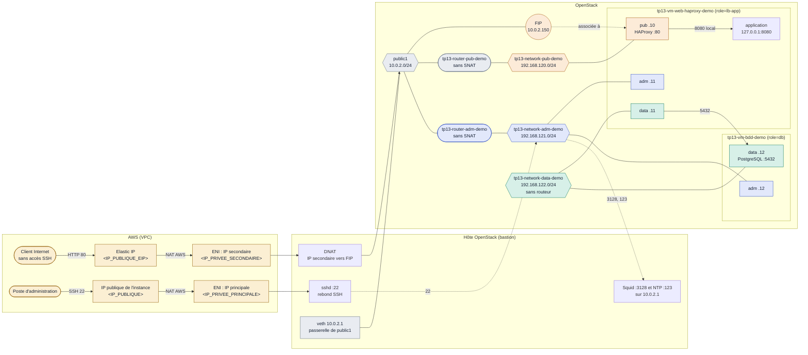
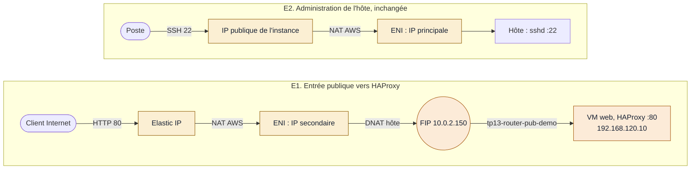
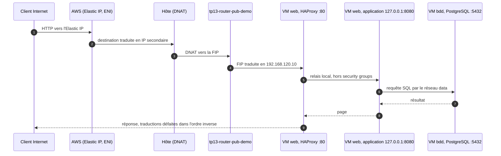

# TP 13. Architecture de déploiement sur OpenStack

> Une application web et sa base de données, publiées sur Internet et protégées comme en production.
> Deux VM : la VM web (HAProxy et l'application) et la VM bdd (PostgreSQL), sur trois réseaux
> séparés : publication, administration et données. L'instance AWS, hôte d'OpenStack, sert de bastion,
> de proxy de sortie et de serveur de temps.
>
> Ce document présente le TP final du parcours et l'architecture que vous allez construire.

| Version | État | Plateforme | Préfixe des ressources |
|---|---|---|---|
| 2026-10-19 | Vérifié sur le lab : chaque étape exécutée telle qu'écrite | Lab All-in-One Kolla-Ansible sur AWS EC2, scénario 04 | `tp13-` |

---

## 1. Ce que vous allez construire

Au terme du parcours, vous déployez de bout en bout une application web et sa base de données.
L'application est publiée sur Internet, et l'ensemble est protégé comme en production : une seule porte
d'entrée, des réseaux séparés par usage, un pare-feu par carte réseau, aucune sortie directe vers
Internet. Vous le faites sur un vrai cloud OpenStack que vous avez vous-même installé, sur une vraie
instance AWS.

**L'infrastructure à créer**

| Élément | Rôle | Où |
|---|---|---|
| Bastion | Seul point d'administration : les VM ne s'administrent qu'en SSH par rebond à travers lui. Aucune clé de VM n'y est stockée. | L'instance AWS, hôte d'OpenStack (10.0.2.1 vu des VM) |
| Proxy Squid | Seule sortie des VM vers Internet : liste blanche de domaines par VM, chaque requête journalisée. | Sur le bastion |
| Serveur de temps (NTP) | Heure des VM, sans accès direct à Internet. | Sur le bastion |
| Pare-feu de l'hôte | Aucun paquet des réseaux du TP ne sort vers AWS sans avoir été traduit par une FIP. | Sur le bastion |
| Réseaux et sous-réseaux | Trois : publication (pub), administration (adm), données (data). | OpenStack |
| Routeurs | Deux, sans SNAT : pub (porte la FIP) et adm (relie le bastion). Le réseau data n'a pas de routeur. | OpenStack |
| Ports | Cinq cartes réseau à adresse fixe, créées avant les VM. | OpenStack |
| Security groups | Quatre, un par rôle de carte, sans aucune sortie par défaut. | OpenStack |
| Paire de clés | Accès SSH aux VM ; la clé privée reste sur le poste. | Poste et OpenStack |
| VM web | HAProxy (publication) et application (écoute locale seulement), dans un service durci ; trois cartes. | OpenStack |
| VM bdd | Base de données PostgreSQL ; deux cartes, aucune sur le réseau de publication. | OpenStack |
| Volume et type de volume chiffré | Données de la base, chiffrées (LUKS). | Cinder, volume attaché à la VM bdd |
| Secret | Mot de passe de la base, jamais écrit en clair dans un fichier. | Barbican |
| FIP | Adresse de publication de HAProxy, fixe : 10.0.2.150. | Réseau externe public1 |
| Publication sur Internet | IP privée secondaire de l'instance, Elastic IP et traduction d'adresse sur l'hôte. Étape optionnelle et payante. | AWS et bastion |
| Échanges | Les flux autorisés entre ces éléments. Tout autre flux est refusé, et chaque refus se vérifie. | Détaillés au § 4 |

**Ce que vous saurez faire**

- Concevoir une architecture réseau segmentée : publication, administration, données.
- Écrire des règles de security group au plus juste, en entrée et en sortie, avec des groupes plutôt
  que des adresses.
- Publier un service sur Internet à travers deux couches réseau, AWS puis OpenStack, et expliquer
  chaque traduction d'adresse.
- Administrer des VM uniquement par un bastion, et contrôler leurs sorties par un proxy filtrant.
- Diagnostiquer une panne réseau avec `tcpdump`, et prouver qu'un flux interdit l'est vraiment.
- Nommer, étiqueter et nettoyer des ressources comme dans une équipe d'exploitation.

**Comment vous apprenez**

- Un lab réel, pas une simulation : OpenStack 2025.1 déployé par Kolla-Ansible, sur AWS EC2.
- Chaque commande des TP est rejouée sur le lab avant publication.
- On fait constater plutôt qu'affirmer : chaque règle de sécurité est vérifiée par un test qui
  réussit et un test qui échoue.
- Des pièges réels, rencontrés pendant la conception du TP, à diagnostiquer vous-même.
- Les coûts sont maîtrisés : tout est gratuit, sauf une étape optionnelle signalée et soumise à
  l'accord du tuteur.

---

## 2. Les principes de sécurité mis en œuvre

Chaque principe correspond à un élément concret de l'architecture, et à un test que vous exécutez.

| Principe | Mise en œuvre dans le TP | Ce que vous vérifiez |
|---|---|---|
| Surface d'exposition minimale | Une seule adresse publique, celle de HAProxy ; la base n'a aucune carte sur le réseau de publication | La base est injoignable depuis le bastion et depuis le réseau pub |
| Séparation des plans | Trois réseaux : publication, administration, données ; deux routeurs ; réseau data sans routeur | Chaque flux emprunte le réseau prévu, et lui seul |
| Moindre privilège | Security groups par rôle de carte ; sources internes désignées par groupe (`remote_group_id`) | Seule l'application joint la base, et seulement sur le port 5432 |
| Filtrage en sortie | Règles de sortie par défaut supprimées sur toutes les cartes ; routeurs sans SNAT | Une VM ne peut ni sortir sur Internet, ni interroger un DNS |
| Point d'administration unique | Bastion SSH ; aucune clé de VM sur le bastion ; clés d'hôte vérifiées | SSH refusé depuis toute autre source |
| Sorties contrôlées et tracées | Proxy Squid à liste blanche de domaines, par VM | Un domaine non autorisé est refusé ; chaque requête est journalisée |
| Défense en profondeur | Security group AWS, security groups OpenStack, routeurs sans SNAT, règle de pare-feu de l'hôte, écoute locale de l'application | Le retrait d'une couche ne suffit pas à ouvrir un flux |
| Secrets et données protégés | Mot de passe de la base dans Barbican, transmis par l'entrée standard ; volume de la base chiffré | Aucun mot de passe en clair dans les fichiers ni dans l'historique |
| Service durci | Application sous un utilisateur créé au démarrage, système en lecture seule, appels système filtrés | Score `systemd-analyze security` relevé |
| Traçabilité | Convention de nommage `tp13-` et étiquette `tp13` sur tout ce qui l'accepte | Inventaire et nettoyage complets |

---

## 3. Plus de dix travaux pratiques pour y arriver

Aucune connaissance d'OpenStack n'est supposée : il faut savoir se servir d'un terminal Linux et de
SSH. Chaque TP apporte une brique que le TP final réutilise.

| TP | Titre | Phase | Repris dans le TP 13 |
|---|---|---|---|
| 00 | Préparer et découvrir l'instance AWS | Avant le déploiement | Accès à l'hôte, Security Group AWS |
| 01 | Déployer OpenStack et vérifier le déploiement | Déploiement | La plateforme elle-même |
| 02 | Lancer des instances depuis l'hôte et s'y connecter en SSH | Utilisation | Rebond SSH, tunnels |
| 03 | Comprendre le réseau Neutron | Utilisation | Réseaux, routeurs, security groups |
| 04 | Stockage persistant : volumes, montage, snapshots | Utilisation | Volume de la base |
| 05 | Exploiter la plateforme : logs, pannes, reconfiguration | Exploitation | Diagnostic |
| 06 | Projets, utilisateurs, rôles et quotas | Exploitation | Organisation des ressources |
| 07 | Floating IP publiques et réseau AWS | Extension | Publication par l'ENI |
| 08 | Gérer des secrets avec Barbican | Extension | Mot de passe de la base |
| 09 | Chiffrer les volumes Cinder | Extension | Volume chiffré |
| 10 | Sauvegarder une VM : dépôt local, stockage objet, copie hors de l'hôte | Extension | Extension possible |
| 11 | DNS as a Service avec Designate | Extension | Extension possible |
| 12 | Configurer les VM au démarrage avec cloud-init | Extension | Image, gabarit, proxy, métadonnées |
| 13 | TP final : architecture de déploiement sur OpenStack | Synthèse | Tout le parcours |
| 14 | TP bonus : la même architecture redéployée avec Heat, décrite en code | Bonus | Reprend le TP 13 |

---

## 4. L'architecture en détail

Chaque élément a été exécuté sur le lab, et son résultat mesuré, avant d'être écrit dans le TP.

| Statut | Sens |
|---|---|
| Vérifié | Exécuté sur le lab ; résultat mesuré |
| Payant | Ressource facturée par AWS, sur accord |

### 4.1 Topologie

Couleurs : orange pour le réseau de publication, bleu pour l'administration, vert pour le réseau
data, gris pour le réseau externe Neutron, jaune pour la couche AWS. Les adresses AWS sont des
marqueurs.

- Les deux routeurs ont leur passerelle sur `public1` avec `--disable-snat`. La FIP fonctionne sans
  SNAT : c'est une traduction un pour un. Vérifié.
- Le MASQUERADE de l'hôte ne traduit que la source `10.0.2.0/24`, et une règle du pare-feu de l'hôte
  refuse vers AWS tout paquet des réseaux `192.168.120.0/22`. Une adresse des réseaux du TP ne peut
  donc pas sortir sur Internet, même par erreur de routage. Vérifié.
- Sur la VM web, le relais de HAProxy vers l'application passe par l'interface locale : il ne traverse
  aucun port Neutron.

### 4.2 Vue de l'ENI : comment une FIP devient joignable depuis Internet

AWS ne connaît pas les VM OpenStack : une Elastic IP ne s'associe qu'à une IP privée de l'ENI de
l'instance. L'IP principale reste celle de l'administration ; une IP secondaire, dédiée à la FIP,
sert de point d'entrée public. L'hôte fait le reste par DNAT.

| Adresse de l'ENI | IP publique associée | Usage | Coût | Statut |
|---|---|---|---|---|
| IP principale `<IP_PRIVEE_PRINCIPALE>` | IP publique de l'instance, change à chaque arrêt | Administration : SSH vers l'hôte, tunnels vers Horizon | Facturée par AWS comme toute IPv4 publique | Vérifié |
| IP secondaire `<IP_PRIVEE_SECONDAIRE>` | Elastic IP, étiquettes `openstack-lab=true` et `openstack-lab-eni` | Entrée publique de l'application, DNAT vers la FIP | IP secondaire gratuite ; Elastic IP environ 0,005 USD/h, jusqu'à sa libération | Payant, vérifié |

- Outils : `aws/aws-public-fip.sh` côté AWS (simulation sans `--apply`, puis confirmation « oui ») et
  `tools/public-fip.sh` côté hôte.
- Le security group AWS filtre toute l'interface, donc toutes ses adresses : ports 22 et 80 ouverts à
  la seule adresse publique du poste, jamais à `0.0.0.0/0`. Sinon, Horizon, servi sur le port 80 de
  l'adresse principale, serait exposé à tout Internet.
- L'entrée n'utilise que HTTP. Le HTTPS est prévu plus tard, avec Horizon en HTTPS.

### 4.3 Parcours des flux, de bout en bout

Le parcours principal, de l'utilisateur jusqu'à la base, avec les traductions d'adresse :

| N° | Parcours | Chemin | Remarque |
|---|---|---|---|
| P1 | Utilisateur vers l'application | Internet, FIP (80), HAProxy sur la VM web, application en local (8080) | Le dernier saut ne traverse aucun port Neutron |
| P2 | Application vers la base | VM web carte data, VM bdd carte data (5432) | Seul flux du réseau data |
| P3 | Administration des VM | Poste, bastion 10.0.2.1 (22), cartes adm des deux VM (22) | Rebond `ProxyJump` ; aucune clé de VM sur le bastion |
| P4 | Sortie des VM : paquets, heure | Cartes adm, Squid 10.0.2.1 (3128) vers les dépôts autorisés (80, 443) ; NTP 10.0.2.1 (123) | Liste blanche propre à chaque VM ; chaque requête journalisée |
| P5 | Exception SSH sortante, niveau avancé | VM web carte adm, Squid (CONNECT), github.com (22) | Le journal montre la destination et le volume, pas le contenu |

**Exercice avancé P5**

1. Constater le blocage : le proxy refuse `github.com:22` (réponse 403), et le refus apparaît dans
   le journal Squid.
2. Ouvrir l'exception : une seule destination dans Squid (`github.com`, port 22, source la VM web),
   et une connexion `ssh -o ProxyCommand='nc -X connect -x 10.0.2.1:3128 %h %p'`.
3. Refaire le test : le refus « Permission denied (publickey) » prouve que la connexion a traversé,
   sans compte ni clé chez GitHub. Contre-test : une autre VM, ou une autre destination, reste
   refusée.
4. Lire le journal :

| Visible dans le journal Squid | Invisible |
|---|---|
| L'heure et la VM source | Les commandes tapées |
| La destination et le port (`CONNECT github.com:22`) | Les fichiers transférés |
| La durée et le volume échangé | Un éventuel tunnel monté à l'intérieur |

Le proxy contrôle à qui on parle, pas ce qu'on dit. Une exception SSH, même étroite, doit rester
rare, justifiée et revue.

### 4.4 Les objectifs de sécurité à atteindre

À vous de traduire ces objectifs en security groups, en routes et en configuration du proxy. Chaque
objectif se valide par deux tests : le flux autorisé fonctionne, le flux interdit échoue.

| N° | Objectif | Preuve attendue |
|---|---|---|
| O1 | L'application est joignable par sa FIP, et seulement sur le port de HAProxy. | Page servie par la FIP (puis par l'Elastic IP à l'étape 15) ; tout autre port refusé |
| O2 | L'application n'est joignable que par HAProxy. | Port de l'application injoignable depuis tout réseau |
| O3 | Seule l'application joint la base, sur un seul port. | Connexion à la base réussie depuis la VM web, refusée ailleurs et sur tout autre port |
| O4 | Les VM ne s'administrent que depuis le bastion. | SSH par rebond réussi ; SSH depuis une autre source refusé |
| O5 | Aucune VM ne sort directement sur Internet. | Accès direct à Internet et au DNS refusé depuis les deux VM |
| O6 | Les sorties passent par le proxy, vers des domaines autorisés seulement. | Mise à jour des paquets réussie ; domaine non autorisé refusé ; refus visible dans le journal |
| O7 | Une seule route par défaut, sur la VM web ; aucune sur la VM bdd. | Tables de routage lues et expliquées |
| O8 | Toutes les ressources suivent la convention de nommage ; celles qui l'acceptent portent l'étiquette `tp13`. | Inventaire par l'étiquette `tp13`, et par le préfixe `tp13-` pour le volume, le type de volume, la clé et le secret ; nettoyage complet |

### 4.5 Ressources et nommage

Convention : `<numero_de_tp>-<type|fonction>-<group>-<phase>`, en minuscules avec des tirets. 

| Type | Nom | Remarque | Statut |
|---|---|---|---|
| Réseaux | `tp13-network-pub-demo`, `tp13-network-adm-demo`, `tp13-network-data-demo` | étiquette `tp13` | Vérifié |
| Sous-réseaux | `tp13-subnet-pub-demo`, `tp13-subnet-adm-demo`, `tp13-subnet-data-demo` | plages dans la topologie | Vérifié |
| Routeurs | `tp13-router-pub-demo`, `tp13-router-adm-demo` | `--disable-snat` sur les deux | Vérifié |
| Security groups | `tp13-sg-web-demo`, `tp13-sg-adm-demo`, `tp13-sg-data-web-demo`, `tp13-sg-data-bdd-demo` | règles de sortie par défaut supprimées | Vérifié |
| Ports | `tp13-port-pub-web-demo`, `-adm-web-`, `-data-web-` ; `tp13-port-adm-bdd-demo`, `-data-bdd-` ; `tp13-port-adm-router-demo` | adresses fixes, créés avant les VM | Vérifié |
| VM | `tp13-vm-web-haproxy-demo` (`role=lb-app`), `tp13-vm-bdd-demo` (`role=db`) | image `debian13` et gabarit `m1.1g`, préparés au TP 12 | Vérifié |
| FIP | 10.0.2.150, description `FIP_PUBLICATION`, étiquette `tp13` | adresse fixe : la même URL pour tous | Vérifié |
| Paire de clés | `tp13-keypair-adm-demo` | pas d'étiquette possible | Vérifié |
| Volume et type | `tp13-cinder-bdd-demo`, type `tp13-cinder-type-luks-demo` | données PostgreSQL, chiffrées ; pas d'étiquette possible | Vérifié |
| Secret Barbican | `tp13-barbican-bdd-demo` | mot de passe de la base ; pas d'étiquette possible | Vérifié |
| Hôte | `/etc/squid/conf.d/tp13.conf`, `/etc/chrony/conf.d/tp13.conf`, route `192.168.121.0/24`, règle FORWARD commentée `tp13` | retirés au nettoyage | Vérifié |
| AWS | IP secondaire et Elastic IP, étiquette `openstack-lab=true` | libérées en fin de TP, vérifié par `list` | Payant |

---

## 5. Séquence d'exécution

Chaque étape dépend des précédentes indiquées : ne passez à la suivante qu'après un contrôle réussi.
L'ordre a ses raisons. Squid doit fonctionner avant le lancement des VM, sinon cloud-init ne peut rien
installer. La route de retour sur l'hôte doit exister avant le premier SSH vers le réseau adm. Les
ports sont créés avant les VM pour imposer les adresses et les groupes. Tout est gratuit, sauf
l'étape 15, optionnelle et payante.

| N° | Lieu | Dépend de | Objectif de l'étape | Contrôle | Retour arrière |
|---|---|---|---|---|---|
| 0 | `[instance]` | aucune | Vérifier la plateforme : `verify.sh` sans échec, image `debian13` et gabarit `m1.1g` présents (TP 12). | `verify.sh` : 0 échec | aucun |
| 1 | `[instance]` | 0 | Créer les trois réseaux et leurs sous-réseaux. Seul le sous-réseau pub annonce une passerelle ; le sous-réseau adm pousse une route vers le bastion. | Passerelles et routes conformes | Supprimer les sous-réseaux puis les réseaux |
| 2 | `[instance]` | 1 | Créer les deux routeurs sans SNAT. Le réseau data n'a pas de routeur. | SNAT désactivé, dans l'API et dans le noyau | Retirer les interfaces, puis supprimer les routeurs |
| 3 | `[instance]` | 2 | Sur l'hôte : route de retour vers le réseau adm, et règle de pare-feu qui refuse vers AWS tout paquet non traduit des réseaux du TP. | L'hôte joint le routeur adm ; règle présente | Supprimer la route et la règle |
| 4 | `[instance]` | 3 | Installer Squid (écoute sur 10.0.2.1 seulement, liste blanche par VM) et servir l'heure par chrony. | Écoutes sur 10.0.2.1:3128 et :123 seulement | Retirer les configurations `tp13`, désinstaller Squid |
| 5 | `[instance]` | 1 | Créer les quatre security groups, supprimer leurs sorties par défaut et écrire les règles. | Aucune sortie vers tout ; sources internes désignées par groupe | Supprimer les groupes (après les ports) |
| 6 | `[instance]` | 1, 5 | Créer les cinq ports à adresse fixe, chacun avec son security group. | Un seul groupe par port, le bon | Supprimer les ports |
| 7 | `[poste]`, `[instance]` | 4, 6 | Créer la paire de clés, puis lancer la VM bdd et la VM web avec le user-data commun. Exercice : la règle des métadonnées. | Console : métadonnées lues, clé installée | Supprimer les VM (les ports restent) |
| 8 | `[poste]`, `[instance]`, `[VM]` | 3, 7 | Se connecter par rebond, après avoir vérifié les clés d'hôte. Exercice : le routage asymétrique, capturé avec `tcpdump`. | Objectif O4 ; capture expliquée | La route revient seule au bout de 40 s |
| 9 | `[instance]`, `[VM]` | 8 | VM bdd : volume chiffré, secret Barbican, PostgreSQL sur le volume, accessible de la seule VM web. | PostgreSQL écoute sur la carte data seulement ; données sur le volume | Supprimer le volume, le type et le secret |
| 10 | `[poste]`, `[VM]` | 9 | VM web : application dans un service durci, HAProxy sur la carte pub. | Écoutes vérifiées ; page « Réussi » | Supprimer la VM |
| 11 | `[instance]`, `[VM]` | 2, 10 | FIP 10.0.2.150 sur le port pub ; routage par source constaté. | Page servie par la FIP depuis l'hôte | Supprimer la FIP |
| 12 | `[instance]`, `[VM]`, `[poste]` | 11 | Prouver les objectifs O1 à O8, chacun par un test autorisé et un test interdit ; test négatif. | Tableau complet | aucun |
| 13 | `[poste]` | 11 | Ouvrir l'application dans le navigateur par un tunnel SSH ; provoquer une panne de la base. | Page affichée ; console sans erreur de CSP | Fermer le tunnel |
| 14 | `[VM]`, `[instance]`, `[poste]` | 12 | Niveau avancé : exception SSH vers une seule destination, puis lecture du journal Squid. | Destination visible, contenu invisible ; autres refus | Retirer l'exception |
| 15 | `[poste]`, `[instance]` | 12 | Optionnel et payant : IP secondaire et Elastic IP, DNAT sur l'hôte ; test depuis un navigateur. | Page servie par l'Elastic IP ; refusée depuis un réseau mobile | Libérer, vérifier par `list` |
| 16 | `[instance]`, `[poste]` | toutes | Nettoyer dans l'ordre inverse, hôte compris. | 0 ressource `tp13` ; `verify.sh` sans échec | aucun |

L'étape 15 se fait uniquement avec l'accord du tuteur.

Compétences des TP précédents réutilisées : réseau et routeurs (TP 03), volumes (TP 04), dépannage (TP
05), publication de FIP (TP 07), secrets (TP 08), volumes chiffrés (TP 09), configuration des VM par
cloud-init (TP 12). La sauvegarde de la base (TP 10) et le nom DNS de l'application (TP 11) sont des
extensions possibles, non retenues.

---

## 6. Choix assumés et points de vigilance

| N° | Point | Détail |
|---|---|---|
| 1 | HAProxy et application sur la même VM | Écart assumé aux bonnes pratiques, pour les ressources du lab. Le flux HAProxy vers l'application échappe aux security groups. Compensation : écoute sur 127.0.0.1 seulement, et service durci qui ne peut joindre que la boucle locale et la base. |
| 2 | Une seule entrée publique | Une IP secondaire et une Elastic IP pour toute l'application ; la VM bdd n'a aucune carte pub. |
| 3 | Aucune sortie directe vers Internet | Routeurs sans SNAT et pare-feu de l'hôte ; toute sortie passe par Squid, filtrée par domaine et journalisée. Le test négatif de l'étape 12 montre que le security group de la carte pub est la seule barrière de la VM web : aucune règle de sortie n'y est permise. |
| 4 | Séparation logique, pas physique | Les deux routeurs partagent l'hôte, l'agent L3 et `public1`. Le bastion est aussi l'hôte OpenStack : sa compromission donne tout le cloud. Ne jamais y poser de clé de VM. |
| 5 | Pile logicielle | Paquets Debian et service systemd durci plutôt que des conteneurs : tout vient de `deb.debian.org` par le proxy déjà en place, sans registre d'images à ouvrir, et la VM n'a que 1 Go de mémoire. |
| 6 | Reporté | HTTPS sur HAProxy (avec Horizon en HTTPS), répartition de charge sur deux serveurs applicatifs, Octavia (non déployé, lourd en All-in-One). |

---

## 7. Glossaire

| Terme | Définition |
|---|---|
| ENI | Interface réseau d'une instance EC2. Elle porte une IP privée principale et peut recevoir des IP privées secondaires. |
| Elastic IP | IP publique fixe d'AWS, associée à une IP privée de l'ENI. Facturée jusqu'à sa libération. |
| DNAT | Traduction de l'adresse de destination ; ici, l'hôte redirige l'IP secondaire vers la FIP. |
| FIP | Adresse du réseau externe Neutron associée à une carte de VM par le routeur. Elle ne filtre rien. |
| SNAT | Traduction de l'adresse source, qui permet aux VM sans FIP de sortir. Désactivé sur les deux routeurs. |
| Security group | Pare-feu *stateful* appliqué à une carte réseau, pas à un logiciel. |
| `remote_group_id` | Source ou destination d'une règle désignée par un groupe : toutes les cartes membres du groupe. |
| `remote_ip_prefix` | Source ou destination désignée par une plage d'adresses ; utilisée pour ce qui n'est pas un port Neutron. |
| Bastion | Point de passage unique pour l'administration ; ici l'hôte OpenStack. |
| Proxy de sortie | Service qui relaie les requêtes web des VM vers Internet (Squid) ; le HTTPS est relayé sans déchiffrement (CONNECT). |
| Routage par source | Choix de la route selon l'adresse source du paquet, et pas seulement sa destination. |
